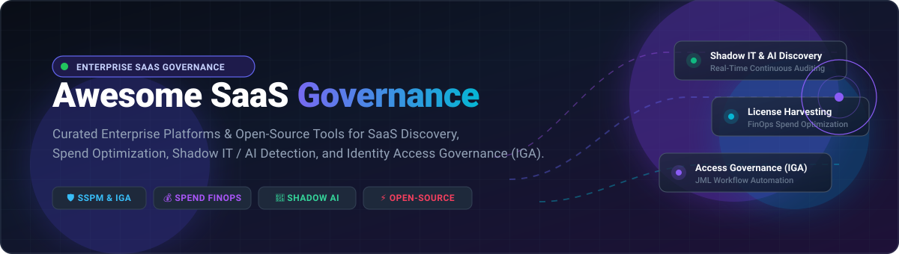

  

# 🌐 Awesome Enterprise SaaS Governance 🛡️

> **A curated, SEO-optimized guide to top Enterprise SaaS Governance platforms, SaaS Management Platforms (SMP), SaaS Security Posture Management (SSPM), and Identity Governance & Administration (IGA) solutions — featuring both leading commercial hosted vendors and open-source alternatives for continuous SaaS discovery, shadow IT detection, spend optimization, license reclamation, and automated compliance.** 📊🔐✨
>
> 🌟 *Star this repository to stay up-to-date with emerging tools in SaaS governance and security!* 🌟

---

## 📋 Table of Contents

- [🌐 Sector Overview & Market Dynamics](#-sector-overview--market-dynamics)
- [🟦 SaaS / Commercial Hosted Platforms](#-saas--commercial-hosted-platforms)
- [🟩 Open-Source Software](#-open-source-software)
- [📊 Feature Comparison Matrix](#-feature-comparison-matrix)
- [📈 Star History](#-star-history)
- [💖 Support](#-support)
- [🤝 Contributing](#-contributing)
- [📄 License](#-license)

---

## 🌐 Sector Overview & Market Dynamics

The global **SaaS Management Platform (SMP) and SaaS Governance** market is estimated at **$1.8B to $2.5B** in 2024 and is projected to surpass **$7.5B by 2032**, expanding at a robust **CAGR of ~16.5%**, propelled by explosive multi-SaaS sprawling, hybrid workforces, and autonomous shadow AI adoption. According to Gartner, organizations actively waste 25% to 30% of their annual SaaS spend on unused, underutilized, or forgotten subscriptions, while unaware of up to 50% of SaaS and AI integrations operating across their estates.

The sector remains **moderately fragmented** rather than a winner-take-all monopoly:
- 🏢 **Enterprise SAM & Cloud Heavyweights** (*Flexera/Snow, SAP LeanIX*) address full software lifecycle, hybrid enterprise architecture, and enterprise asset compliance.
- ⚡ **Dedicated SaaS Management Platforms (SMP)** (*Torii, Zylo, BetterCloud, Zluri*) concentrate primarily on continuous shadow IT discovery, spend optimization, FinOps license harvesting, and automated onboarding/offboarding workflows.
- 🛡️ **Identity & Access Governance (IGA)** (*SailPoint, Lumos*) enforce strict identity entitlement boundaries, role-based access control (RBAC), and recurring access certifications.
- 🔓 **Open-Source Innovations** (*Keycloak, Authentik, Teleport, OPA, Steampipe, CloudQuery*) allow cost-conscious engineering teams to self-host posture audits, asset inventories, and unified IAM/RBAC federation.

---

## 🟦 SaaS / Commercial Hosted Platforms

Commercial, enterprise-grade cloud-hosted governance platforms sorted in descending order by company scale (market valuation / parent enterprise valuation / annual revenue).

| Vendor / Platform | Company Scale (Valuation / Revenue) | Starting Pricing (Specific Tier) | Free Tier Limit / Free Trial Days & Limits | Core Focus & Best For |
| :--- | :--- | :--- | :--- | :--- |
| **[Atlassian Cloud Enterprise](https://www.atlassian.com/enterprise/cloud)** | **~$45B Market Cap** (~$4.4B ARR) | **$4.00/user/month** (Atlassian Guard Standard for centralized SSO/audit logs; Guard Standard included in Enterprise tier) | **30-day free trial** of Atlassian Guard Standard with full SSO & directory sync features; Free Plan available for up to 10 users on core tools (Jira/Confluence) | Centralized admin hub, SSO, automated provisioning, domain verification, and data residency for enterprise Atlassian estates. |
| **[LeanIX (SAP)](https://www.leanix.net/)** | **~$1.3B Acquisition Valuation** by SAP (~$100M+ ARR) | **~$20,000/year** base tier (priced per application portfolio size rather than user seats, supporting unlimited users) | **No free trial** for enterprise commercial edition; academic edition available for universities and non-profits upon request | Enterprise architecture management, SaaS intelligence, and business capability portfolio rationalization. |
| **[SailPoint](https://www.sailpoint.com/)** | **~$12.8B Public Valuation** (~$1.1B ARR) | **$60 - $90/managed identity/year** (typical negotiated enterprise rates $30–$55/identity/year; base packages start at ~$75,000/year) | **No public free trial**; guided enterprise proof of concept (PoC) and health checks available via sales | Enterprise identity governance and administration (IGA), continuous access reviews, role lifecycle management, and separation of duties. |
| **[Snow Software (Flexera)](https://www.flexera.com/products/snow-software)** | **~$500M Acquisition Valuation** by Flexera (~$100M+ ARR) | **~$15,000 - $25,000/year** starting contract (custom quote based on managed device/cloud/SaaS endpoints) | **No free trial** for full Snow License Manager; 14-day to 30-day targeted free trial available for Snow Commander (hybrid cloud management) | Comprehensive Software Asset Management (SAM), SaaS spend tracking, and audit-ready license compliance across hybrid infrastructures. |
| **[BetterCloud](https://www.bettercloud.com/)** | **~$210M - $300M Valuation** (~$55M ARR) | **$0/month** (Spend Optimization Basic tier); paid automation tiers start at **~$3.00 - $6.00/user/month** (~$10,000/yr min) | **Free Plan forever** for Spend Optimization Basic; **14-day to 21-day free trial** for File Governance & Google Workspace security modules | SaaS operational management, automated zero-touch onboarding/offboarding workflows, and granular permission enforcement. |
| **[Lumos](https://www.lumos.com/)** | **~$298M Valuation** (~$15M - $25M ARR) | **~$27,000/year** platform baseline (scaled according to connected user headcount and integration modules) | **No public free trial or free forever plan**; proof of concept (PoC) evaluation available upon scheduling an enterprise sales consultation | App Store access requests, automated access reviews (AccessReviewer), and unified identity governance for modern IT teams. |
| **[Torii](https://www.toriihq.com/)** | **~$200M Valuation** (~$18M - $22M ARR) | **$0/month** (Basic Discovery tier for initial browser/SSO tracking); paid tiers start at **~$12,000 - $18,000/year** | **Free tier available** for basic SaaS mapping; **14-day free trial** with access to automated discovery, shadow IT alerts, and workflow builders | Shadow IT discovery, multi-source SaaS tracking, automated onboarding/offboarding, and license waste reclamation. |
| **[CoreView](https://www.coreview.com/)** | **~$150M - $200M Valuation** (~$18M - $25M ARR) | **~$15,000 - $20,000/year** base agreement (starts at approximately **$2.00 - $4.00/licensed M365 user/month**; unlimited IT admins) | **No self-serve free trial**; free Microsoft 365 environment health check and tenant savings assessment available via demo request | Dedicated Microsoft 365 tenant governance, advanced RBAC delegation, license harvesting, and workflow automation. |
| **[Zylo](https://zylo.com/)** | **~$100M Valuation** (~$30M - $40M ARR) | **~$25,000 - $35,000/year** base enterprise contract (scaled by total employee count and managed software spend) | **No public free trial or free plan**; custom data intake demonstration and enterprise ROI benchmarking upon request | SaaS spend visibility, contract renewal management, benchmark-driven negotiation intelligence, and FinOps consolidation. |
| **[Zluri](https://www.zluri.com/)** | **~$80M Valuation** (~$10M - $15M ARR) | **$4.00 - $8.00/user/month** (enterprise contracts typically require a **$10,000/year** minimum threshold) | **14-day free trial** / sandbox proof-of-concept available upon guided onboarding demo; no permanent free tier | Modern SaaS management platform with AI shadow IT/shadow AI detection, automated access provisioning, and contract management. |

---

## 🟩 Open-Source Software

Self-hosted, community-maintained SaaS governance, identity lifecycle, cloud asset discovery, and security posture management frameworks. Sorted in descending order by GitHub stargazers count.

| Project & Repository | Stars_Badge (Stargazers Link) | Technology Stack | License | Description & Governance Value |
| :--- | :---: | :--- | :--- | :--- |
| **[Keycloak](https://github.com/keycloak/keycloak)** |  | Java | Apache 2.0 | Standard-bearer for open-source Identity & Access Management (IAM), User Federation, Single Sign-On (SSO), OpenID Connect/SAML 2.0, and centralized identity governance. |
| **[Authelia](https://github.com/authelia/authelia)** |  | Go | Apache 2.0 | Lightweight authentication and authorization server providing 2FA/MFA, single sign-on, and security proxy gating for web apps and internal SaaS endpoints. |
| **[Authentik](https://github.com/goauthentik/authentik)** |  | Python / TypeScript | GPL-3.0 | Modern open-source identity provider and SSO gateway featuring flexible policy engines, SCIM provisioning, user self-service portals, and OAuth/OIDC/SAML integrations. |
| **[Teleport](https://github.com/gravitational/teleport)** |  | Go | AGPL-3.0 | Zero-trust access plane providing cryptographic identity-based access control, session recording, and automated access requests for internal web apps, APIs, and infrastructure. |
| **[Zitadel](https://github.com/zitadel/zitadel)** |  | Go | Apache 2.0 | Turnkey multi-tenant identity infrastructure, authentication platform, and role-based access management with built-in audit trails and self-service capabilities. |
| **[Open Policy Agent (OPA)](https://github.com/open-policy-agent/opa)** |  | Go (Rego) | Apache 2.0 | Cloud-native computing foundation general-purpose policy engine enabling unified, context-aware policy enforcement across microservices, Kubernetes, and SaaS applications. |
| **[Steampipe](https://github.com/turbot/steampipe)** |  | Go / SQL | AGPL-3.0 | Zero-ETL SQL query engine with plugins for Google Workspace, Slack, GitHub, AWS, Azure, and Okta — ideal for instant posture compliance checking and SaaS asset querying. |
| **[CloudQuery](https://github.com/cloudquery/cloudquery)** |  | Go | MPL-2.0 | High-performance open-source ELT data pipeline extracting cloud assets and SaaS configurations (Okta, GitHub, Zoom) into analytical databases for governance dashboards. |
| **[Permify](https://github.com/Permify/permify)** |  | Go | Apache 2.0 | Open-source authorization-as-a-service inspired by Google Zanzibar for modeling fine-grained relationship-based access control (ReBAC) and RBAC in distributed SaaS architectures. |
| **[Cerbos](https://github.com/cerbos/cerbos)** |  | Go | Apache 2.0 | Decoupled authorization and permission layer that evaluates context-aware access policies written in YAML, delivering sub-millisecond access decisions for enterprise SaaS. |
| **[ElectricEye](https://github.com/jonrau1/ElectricEye)** |  | Python | Apache 2.0 | Multi-cloud and SaaS posture management CLI executing 1,196 checks across 100+ services including ServiceNow, Salesforce, M365, and Snowflake mapped to 20+ regulatory frameworks. |
| **[Evolveum midPoint](https://github.com/Evolveum/midpoint)** |  | Java | Apache 2.0 | Leading open-source Identity Governance & Administration (IGA) system featuring automated provisioning, access certification campaigns, and comprehensive RBAC hierarchies. |
| **[Apache Syncope](https://github.com/apache/syncope)** |  | Java | Apache 2.0 | Comprehensive Apache Top-Level Identity & Access Management (IAM) and IGA solution managing identities, SCIM/SAML integration, access policies, and automated lifecycle tasks. |
| **[Aperio](https://github.com/writer/aperio)** |  | Go / Next.js | MIT | Open-source SaaS Security Posture Management (SSPM) engine for SIEM-native teams, detecting OAuth shadow IT, third-party token scopes, and streaming posture events to Splunk/Datadog. |
| **[SaaS Security Posture Dashboard](https://github.com/CyberEnthusiastic/saas-security-posture)** |  | Python (stdlib) | MIT | Standalone zero-dependency Python tool for SaaS spend analysis, shadow IT detection, OAuth risk scoring, and subscription rationalization with instant cost-savings reports. |

---

## 📊 Feature Comparison Matrix

| Solution | Deployment Type | Primary Domain | Shadow IT & AI Discovery | License & Spend Optimization | Automated Deprovisioning | Compliance & RBAC Audit |
| :--- | :--- | :--- | :---: | :---: | :---: | :---: |
| **Atlassian Enterprise** | Commercial Hosted | Ecosystem Governance | ❌ | ⚠️ (Atlassian only) | ✅ | ✅ |
| **LeanIX (SAP)** | Commercial Hosted | Enterprise Architecture | ✅ | ✅ | ❌ | ✅ |
| **SailPoint** | Commercial / Hybrid | Identity Governance (IGA) | ⚠️ (Via Identity) | ❌ | ✅ | ✅ |
| **Snow Software** | Commercial Hosted | Software Asset Mgmt (SAM) | ✅ | ✅ | ⚠️ | ✅ |
| **BetterCloud** | Commercial Hosted | SaaS Ops & Automation | ✅ | ✅ | ✅ | ✅ |
| **Lumos** | Commercial Hosted | IGA + App Store | ✅ | ✅ | ✅ | ✅ |
| **Torii** | Commercial Hosted | SaaS Management (SMP) | ✅ | ✅ | ✅ | ✅ |
| **CoreView** | Commercial Hosted | M365 Governance | ✅ (M365) | ✅ (M365) | ✅ | ✅ |
| **Zylo** | Commercial Hosted | Spend Optimization | ✅ | ✅ | ⚠️ | ✅ |
| **Zluri** | Commercial Hosted | SMP + Shadow AI | ✅ | ✅ | ✅ | ✅ |
| **Keycloak** | Open-Source Self-Hosted | Identity & Access (IAM) | ❌ | ❌ | ✅ | ✅ |
| **Authentik** | Open-Source Self-Hosted | IdP & SSO Gateway | ❌ | ❌ | ✅ | ✅ |
| **Teleport** | Open-Source Self-Hosted | Zero-Trust Access | ❌ | ❌ | ✅ | ✅ |
| **Steampipe** | Open-Source Self-Hosted | Multi-SaaS SQL Auditing | ✅ | ⚠️ (Via queries) | ❌ | ✅ |
| **CloudQuery** | Open-Source Self-Hosted | Cloud & SaaS Asset ELT | ✅ | ⚠️ (Via analytics) | ❌ | ✅ |
| **ElectricEye** | Open-Source Self-Hosted | SSPM Posture CLI | ✅ | ❌ | ❌ | ✅ |
| **Evolveum midPoint**| Open-Source Self-Hosted | Identity Governance (IGA) | ❌ | ❌ | ✅ | ✅ |
| **Apache Syncope** | Open-Source Self-Hosted | IAM & IGA Platform | ❌ | ❌ | ✅ | ✅ |
| **Aperio** | Open-Source Self-Hosted | SSPM & OAuth Auditing | ✅ | ❌ | ❌ | ✅ |
| **SaaS Security Posture**| Open-Source Self-Hosted| Cost Rationalization | ✅ | ✅ | ❌ | ⚠️ |

---

## 📈 Star History

---

## 💖 Support

Thank you so much for visiting and utilizing this guide! 🙏

If you found this curated Enterprise SaaS Governance repository helpful to your organization, engineering workflows, or research:
- ⭐ **Star** this repository to help other IT, FinOps, and cybersecurity teams discover it!
- 🍴 **Fork** it to build and customize your own internal enterprise tooling evaluation matrix.
- 📢 **Share** it with your engineering colleagues on LinkedIn, Reddit, or X/Twitter.

If you would like to sponsor ongoing open-source curation and research:

Or visit the [GitHub Sponsors Dashboard](https://github.com/sponsors/ishandutta2007) directly. Thank you for your generosity and support! ☕✨

---

## 🤝 Contributing

Contributions are warmly welcomed! If you would like to submit a new SaaS governance solution, identity security tool, or open-source posture auditor:

1. Fork this repository.
2. Create your feature branch (`git checkout -b feature/add-new-governance-tool`).
3. Add the project with required details (pricing/free tier limits, company valuation/scale, or GitHub Stars_Count badges).
4. Commit your changes (`git commit -m "docs: add new SaaS governance solution"`).
5. Push to the branch (`git push origin feature/add-new-governance-tool`).
6. Open a Pull Request.

Please ensure all submissions adhere to standard markdown formatting and link to active, reputable repositories or vendor portals.

---

## 📄 License

This repository is licensed under the [Creative Commons Zero v1.0 Universal (CC0-1.0)](LICENSE) Public Domain Dedication. All listed commercial products and open-source software retain their respective trademarks, copyrights, and licenses.
